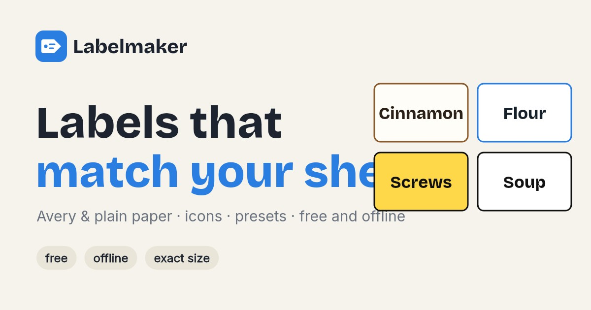
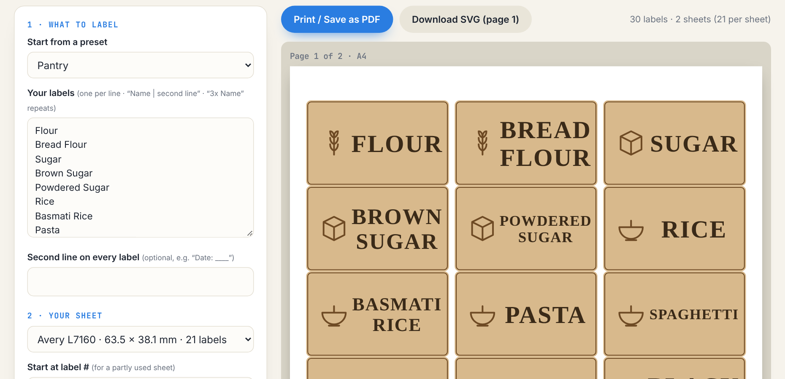

<div align="center">



# Labelmaker

**Labels that match your sheets.**<br>
Type a list, pick your label sheet (Avery or plain paper) and print matching labels with icons, at exactly the right size.

[**Try it live →**](https://labelmaker-ruby.vercel.app) · [Report an issue](https://github.com/mskraban/labelmaker/issues)

[](https://github.com/mskraban/labelmaker/actions/workflows/ci.yml)
[](LICENSE)


</div>

---

<p align="center"></p>

## Why

Spice jars, pantry tubs, workshop drawers, freezer bags: everybody wants matching labels and nobody wants to fight a word processor to line text up with a sticker sheet.

- 🏷️ **15 real sheet formats**: Avery L7160–L7165, L7651, US 5160/5163/5164, round 40/50 mm, and plain-paper grids. Or enter your own measurements.
- 🔢 **A quantity for every label.** Switch the list to the “Quantities” view and set how many of each to print (10 of the first, 5 of the second, 3 of the third…). It shows the total, the sheets needed and how many spots stay empty. The same works in text with `10x Name`.
- ⚡ **Seven presets** (spices, pantry, baking, freezer, workshop, garden, craft) or paste your own list.
- 🎨 **22 looks**: classic, apothecary, kraft, chalkboard, gingham, stripes, polka dots, notebook, black & gold, terracotta, stamp and more, with accent colours and icons chosen from the words (a leaf for herbs, wheat for flour, a snowflake for the freezer).
- 🔤 **16 fonts** (serif, sans, condensed, handwriting, typewriter, marker…), all bundled so it works offline, including č š ž and other accents. Text size and letter case are adjustable.
- ⭕ **Round, square, oval, pill or rounded labels** on plain paper, so they are easy to cut out.
- 📅 **Dates**: write-in lines, today's date, a date you pick, or packed + use-by (“+3 months”) in seven formats, with adjustable size and bold.
- 💾 **Saved designs.** Name a design and it is kept in your browser (localStorage) with every setting: list, sheet, shape, look, font, date and print offsets. Load, overwrite or delete it any time. Your last session is restored automatically.
- 🖨️ **Black & white mode** for printing without colour ink: white paper, black print, dark themes inverted.
- 📥 **Download PNG (300 dpi) or SVG** with the font embedded, or print / save as PDF.
- 📏 **Exact size.** Output is SVG in millimetres, so it prints at the sheet's true dimensions.
- 🧩 **Partly used sheet?** Start at label #7 and the first six stay blank.
- 🔧 **Print fine-tuning**: shift the grid by tenths of a millimetre until it lines up.
- ✂️ **No sheets? No problem.** Plain-paper layouts print cutting outlines.
- ✅ **Text always stays inside the label.** Widths are measured with the real font, and `npm run check-fit` verifies ~110,000 text elements across every theme, font, shape and sheet.
- 🔒 **Private and offline.** Nothing is uploaded. No AI, no tracking, no dependencies.

## Run it

```bash
git clone https://github.com/mskraban/labelmaker.git
cd labelmaker
npm run dev        # or open public/index.html with any static server
```

Print at 100% (“Actual size”). In the print dialog choose “Save as PDF” to keep a copy.

## Use the engine in your own project

```js
const L = require('./public/engine.js');
const labels = L.parseList('Flour\n3x Salt | fine\nSoup | Date: ____');
const pages = L.render(L.sheetById('a4-grid-4x8'), labels, {
  theme: 'gingham', font: 'lora', shape: 'circle', mono: false, skip: 4,
  dates: [{ type: 'text', text: 'Packed ' + L.formatDate(new Date(), 'dmy.') }],
});
// pages[0] is a complete SVG string (210 × 297 mm) ready to save or print
```

Other exports: `SHEETS`, `THEMES`, `FONT_LIST`, `PRESETS`, `ICONS`, `customSheet()`, `layout()`, `fitText()`, `setMeasurer()`, `formatDate()`, `addTime()`, `monoTheme()`, `iconFor()`. In a browser, call `setMeasurer()` with a canvas-backed function so text is fitted with the real font's widths (the app does).

## Sheet data

The measurements follow the manufacturers' templates. If your pack is off by a fraction of a millimetre, use the shift controls, and please open an issue or pull request with the correct numbers. A test checks that every sheet fits its paper.

## Contributing

New sheet formats, themes, icons and presets are the easiest first contributions. See [CONTRIBUTING.md](CONTRIBUTING.md).

## Licence

[MIT](LICENSE). Fonts under the SIL Open Font License, see [NOTICE.md](NOTICE.md). Avery is a trademark of its owner; this project is not affiliated with or endorsed by Avery.

<p align="center"><sub>Same family: <a href="https://github.com/mskraban/cakecalc">Cakecalc</a> · <a href="https://github.com/mskraban/worldscape">Worldscape</a> · <a href="https://github.com/mskraban/seedscape">Seedscape</a></sub></p>
